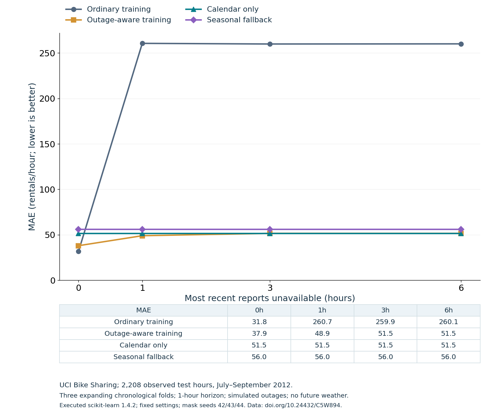

# Forecast Outage Lab

A reproducible reporting-delay stress test for next-hour demand forecasting. It answers a deployment question: **what happens when the last few observations have not arrived?**

This repository contains a new executed experiment and a reusable audit tool, using established algorithms. It does not claim a novel forecasting algorithm, state-of-the-art performance or production validation.

**New tool, 12 October:** [reporting-age fallback and mixed-delay replay](experiments/2026-10-12/README.md). A tested reusable Python router switches forecasts when demand reports are stale. Mean MAE across five synthetic delay schedules was 38.5 versus 99.0 for always ordinary and 41.9 for always outage-aware; the one-hour constant-delay case favored outage-aware. This reuses the already examined benchmark and is labelled exploratory. [Protocol, code, all results and 24 checks](experiments/2026-10-12/README.md); no hosted app or new algorithm is claimed.



## Findings from the recorded run

Three expanding chronological folds evaluated **2,208 observed hourly targets in July–September 2012** in UCI Bike Sharing. Every model and outage scenario used the same test rows. Models retrained only at each month boundary, with no test-based tuning.

| Training / fallback | No added delay | 1h delay | 3h delay | 6h delay |
| --- | ---: | ---: | ---: | ---: |
| Ordinary HGB | 31.8 | 260.7 | 259.9 | 260.1 |
| Outage-aware HGB | 37.9 | 48.9 | 51.5 | 51.5 |
| Calendar-only HGB | 51.5 | 51.5 | 51.5 | 51.5 |
| Seasonal fallback | 56.0 | 56.0 | 56.0 | 56.0 |

Numbers are pooled **MAE in rentals/hour; lower is better**. Exact values, RMSE and per-month variation are in [metrics.csv](results/metrics.csv), [fold-metrics.csv](results/fold-metrics.csv) and [results.json](results/results.json). These are our executed results, not a table copied from a paper.

Ordinary training had the best undelayed MAE but degraded sharply when recent reports were masked. A fixed missing-history training recipe improved delay behavior, with a clean-data cost: **37.9 versus 31.8 MAE**. It was not always the best delayed option: calendar-only MAE was slightly lower than outage-aware MAE at 3h and 6h in the pooled run, and per-month rankings also varied. Native NaN support is not evidence that a model is robust to the missingness pattern encountered in use.

Use this tool to test an explicit reporting-delay assumption alongside ordinary accuracy. Do not adopt the training recipe solely from this small benchmark.

## Reproduce

Recorded environment: Python 3.12.9, NumPy 1.26.4, pandas 2.2.2, scikit-learn 1.4.2, Matplotlib 3.10.0 and threadpoolctl 2.2.0. The full estimator configuration, platform and input hashes are saved in results.json. Two computational threads were used; no speed claim is made.

```bash
python -m venv .venv
# Activate the environment using your operating system's normal command.
python -m pip install -r requirements.txt
python experiment.py --check-only
python experiment.py --output results
```

The full run downloads the public UCI archive into ignored `data/`, builds an hourly grid, fits nine small models and writes predictions, metrics, an editable SVG and a PNG. Inspect the newly written data hashes against the recorded run. Network access is needed on the first run; `--check-only` is offline after dependencies are installed. CPU/library differences may produce small floating-point differences.

For a custom run, supply another output directory and optionally `--cache PATH`. The functions `features`, `mask_training` and `seasonal_fallback` can also be imported into a separate evaluation. `features` requires a complete hourly grid and supports reporting delays from 0 to 23 hours; the recorded benchmark uses 0/1/3/6. Other horizons, outage lengths and tasks require a changed protocol and fresh results.

## What the audit does

- Forecast y[t] using only calendar values and demand observed strictly before t. No current weather, casual/registered counts or future targets.
- Preserve **165 missing hourly timestamps** in the 17,544-hour grid as NaN. The source CSV has **17,379 rows**; the UCI page's displayed instance count differs, so this report uses the downloaded file's count.
- At each forecast origin, hide the latest k hourly reports, mask dependent lags and recompute rolling features from the remaining history. Older reports recover at the next appropriate origin. This is a simulated reporting delay, not a quarter-long permanent outage.
- Train outage-aware HGB on the same number of rows as ordinary HGB; replace each row's features with a preset mask (50% unmasked, the rest evenly 1/3/6h). Fixed seeds 42/43/44, one draw per fold. Both use 150 iterations, 15 leaves and Poisson loss; early stopping is disabled.
- Compare with calendar-only HGB and a transparent 168h → 24h → training-median fallback. The fallback remains unaffected by delays shorter than 24h in this protocol.
- Run **16 checks** covering future-target and hidden-observation invariance, natural missingness, hourly-grid validation, mask determinism, fallback precedence, finite forecasts and matched test rows. See [PROTOCOL.md](PROTOCOL.md) and the recorded checks in results.json.

## Limits

One historical city and one quarter do not establish general applicability. Outages are simulated and training missingness is a preset recipe. There is one mask draw per fold, no hyperparameter search, no repeated-seed uncertainty estimate and no production outage test. Earlier held-out observations are available at later rolling origins; these are **one-hour-ahead forecasts**, not a forecast of the entire quarter made once. Weather forecasts, event signals, more outage mechanisms, other cities and prospective validation remain untested.

## Data, methods and attribution

Data: Fanaee-T, H. (2013), [Bike Sharing, UCI](https://archive.ics.uci.edu/dataset/275/bike+sharing+dataset), [DOI](https://doi.org/10.24432/C5W894), **CC BY 4.0**. Raw data is downloaded by the script and is not bundled. Prediction files contain attributed public aggregate hourly rental counts, not personal records.

Methods: [scikit-learn lagged forecasting example](https://scikit-learn.org/stable/auto_examples/applications/plot_time_series_lagged_features.html) provides background; [HGB API](https://scikit-learn.org/stable/modules/generated/sklearn.ensemble.HistGradientBoostingRegressor.html) documents missing-value handling. Our calendar, outage protocol and outputs differ from the documentation example. The executed library version is 1.4.2, distinct from the current stable documentation.

Code is MIT licensed. Public data retains its separate CC BY 4.0 attribution. See [source-ledger.json](source-ledger.json), [PROTOCOL.md](PROTOCOL.md) and [run.log](run.log).
