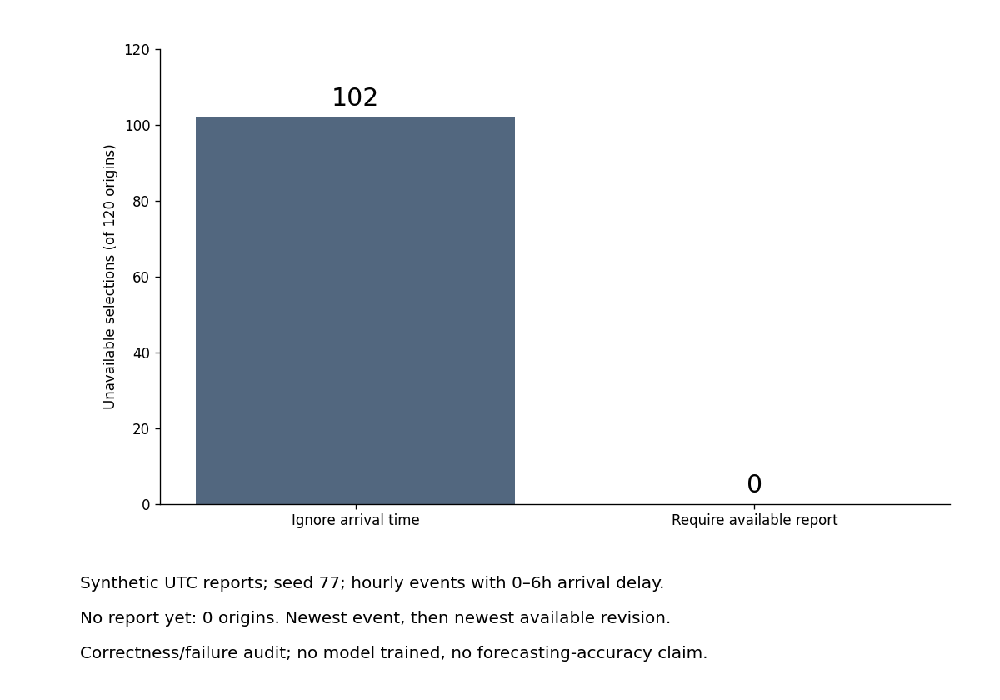

# Arrival-aware report selection — reserved backup

A new tested Python utility for developers and operations teams reading a **single report stream** with delayed or corrected observations. It requires both the event time and the time the report actually became available, then selects the latest event and its latest available revision at a given origin. Returns None if no report has arrived. It does not choose the newest arrival blindly, which could roll back to an older event.

```bash
python -m pip install -r requirements-sweep.txt
python arrival_audit.py --check-only
python arrival_audit.py --output my-arrival-audit
```

The function `select_report(frame, origin)` requires event_time, available_at and finite nonnegative value columns, plus timezone-aware timestamps. It preserves input objects, rejects ambiguous duplicated revisions and arrival-before-event clocks. Extra entity columns are not interpreted: call it separately per entity/stream. This is an in-memory correctness reference, not a production ingestion service or speed benchmark.



On 120 **explicitly synthetic** hourly UTC reports with seeded 0–6h arrival delays, the naive event-only selector chose an unavailable report at **102 origins**. The availability-aware selector did so at **0**; there were **0 no-report origins** in this particular draw. Seed 77. All input rows and decisions are saved, including failures. No forecast model was trained and this does not measure forecasting accuracy or business impact.

Nine meaningful checks cover unarrived/future records, exact time boundaries, late arrivals of older events, available corrections, empty/no-history behavior, future-value invariance, input immutability, schema/clock/value errors and naive origins. The first test run caught an empty-input dtype issue; UTC dtype is now retained explicitly and the entire check/audit run passed. Trustworthy arrival clocks remain an assumption.

Source: the official [Feast point-in-time documentation](https://docs.feast.dev/getting-started/concepts/point-in-time-joins), section on restricting created timestamps, supports the availability distinction. This implementation does not run Feast or claim to reproduce its performance. Code and newly generated synthetic data are MIT licensed. Protocol, script, inputs, outputs, environment and run log are retained.

This contribution is a **verified unused backup**, not a second October 13 LinkedIn post. Keep it reserved and check novelty/activity again before any future publication. It can support a later integrated audit, which still needs its own new tested contribution.
