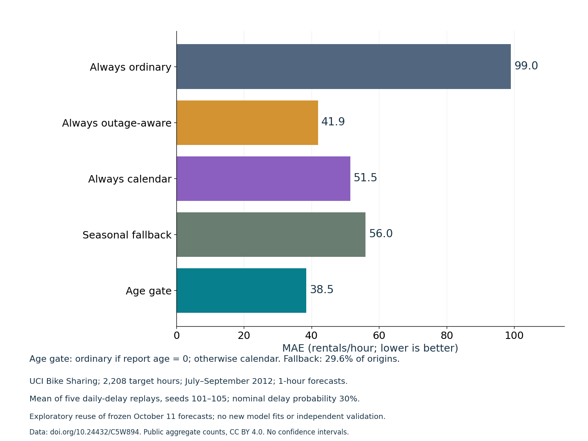

# A reporting-age gate for demand forecasts

For operations analysts and ML developers who need a safe, inspectable prediction-selection rule when demand reports arrive late. This release adds a reusable age calculator and validated prediction router, plus an executed replay. The zero-age trigger was fixed before this run; yesterday's already-examined outcomes motivated it. This is **exploratory benchmark reuse**, not independent validation or a novel forecasting algorithm.

## Use

From the repository root, install requirements.txt and run:

```bash
python fallback_policy.py --check-only
python fallback_policy.py --output experiments/2026-10-12
```

The replay verifies the frozen original prediction file's SHA256. It uses public UCI data (downloaded into ignored data/ if needed), runs the checks, writes row-level decisions and metrics, and exports PNG/SVG. It fits **zero new models**. Do not overwrite the original results/predictions.csv with a new model run and expect a byte-identical replay; use another output directory for retraining. The original nine-model training command remains documented in the root README.

Import the router into a pipeline using your own ordinary and fallback predictions:

```python
from fallback_policy import route_forecasts
predicted, fallback_used = route_forecasts(
    age_hours=[0, 1, float('nan')],
    ordinary=[120, 135, 130],
    fallback=[110, 115, 112],
)
# Illustrative API inputs, not benchmark measurements: [120, 115, 112].
```

Age zero means the report for t−1 is available at the forecast origin. Stale/unknown age or an invalid primary prediction selects the calendar fallback. The fallback array must be finite/nonnegative. Routing does not inspect targets or error metrics. `report_age_hours` calculates age from past observations on a complete hourly grid, respecting the declared delay; it returns infinity if no report is available in the preceding 24h. This is an hourly example contract, not a general timestamp service. NaN means genuinely unavailable, not an observed zero.

## Executed findings



Five synthetic daily-delay schedules reused **the same 2,208 historical target hours** from July–September 2012. Seeds 101–105; delay 0/1/3/6h, nominal probabilities 70/10/10/10%. These are overlapping replays, not 11,040 independent observations. Average actual delayed/fallback fraction: **29.6%**.

| Method | Mean replay MAE (rentals/hour) |
| --- | ---: |
| Always ordinary HGB | 99.0 |
| Always outage-aware HGB | 41.9 |
| Always calendar HGB | 51.5 |
| Seasonal fallback | 56.0 |
| Fixed age gate | 38.5 |

All schedules and per-month outcomes are retained in metrics.csv and fold-metrics.csv; all predictions and routing decisions in predictions.csv. RMSE is also recorded. mixed-summary.csv averages per-replay metrics with equal weights. `fallback_fraction` describes the age gate's routing; it is set to zero for non-routing baselines and is not their availability rate.

The gate preserves undelayed ordinary-model MAE **31.8** in the homogeneous 0h case. It is not a universal winner: under constant 1h delay its MAE is **51.5**, worse than always outage-aware at **48.9**. With stale inputs it intentionally discards demand-history signals. No time-saving, deployment or inferential-significance claim is made.

## Evidence and limits

**24 passed checks**: the original 12 causal-feature checks plus report-age causality/missingness, hidden-report invariance, deterministic schedules, shape/numerical validation, input immutability, frozen source/target identity, matched rows and repeated-routing parity. No test requires a favorable performance result. Python 3.12.14; core versions match repository pins. Exact installed environment: environment-lock.txt. Command/output: run.log. Protocol saved before execution: PROTOCOL.md. Actual outputs and environment: results.json.

One city, one previously exposed quarter, fixed historical estimators and synthetic delays. Trusted report timestamps are required; wrong clocks and >23h delays are not evaluated. This is a tested reusable Python tool, with a local runner; it is **not a hosted app**. The next planned integrated app release is separate and has not been executed here.

Data: Fanaee-T, H. (2013), [UCI Bike Sharing](https://doi.org/10.24432/C5W894), **CC BY 4.0**. The predictions contain redistributable aggregate counts; raw data is not bundled. Code is MIT; data retains CC BY attribution. Source ledger: source-ledger.json. Established HGB behavior is documented in [scikit-learn 1.4.2](https://scikit-learn.org/1.4/modules/ensemble.html#missing-values-support); missing-value support does not establish robustness.
