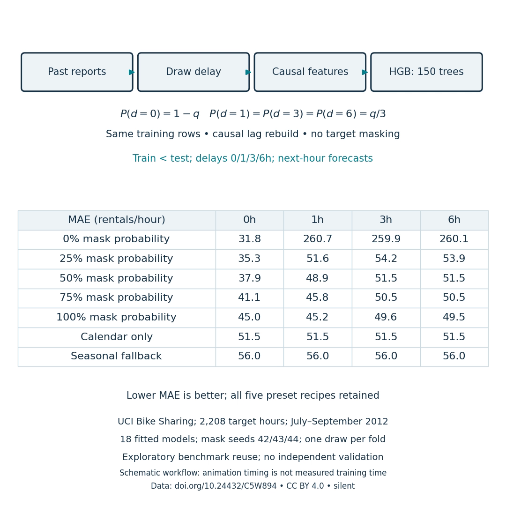

# Configurable missing-history training

A tested Python API and CLI experiment for operations analysts and ML developers assessing reporting-delay resilience. It extends the original fixed 50% recipe into a **preset 0/25/50/75/100% probability sweep**. Targets, feature columns, training rows and estimator budget stay matched. All recipes and baselines are published; no production recipe is automatically chosen.

[](masking-workflow.mp4)

[Download the 20-second silent workflow MP4](masking-workflow.mp4). The animation is a schematic explanation followed by actual measured values; its playback timing is not training latency. [Static measured figure](masking-mae.png) and [editable SVG](masking-mae.svg) are also available.

## Run the recorded sweep

From the repository root:

```bash
python -m pip install -r requirements-sweep.txt
python masking_sweep.py --check-only
python masking_sweep.py --output my-sweep
```

Use a new output directory to preserve the recorded outputs. The script downloads the byte-verified public UCI archive into ignored data/ on first use, trains **18 small estimators**, and writes every prediction, pooled/per-month metrics, actual mask counts, configuration/environment and figures. It requires the original archived results/predictions.csv to report numerical parity; it does not overwrite them.

For your own local studies, import `mask_with_probability(counts, train_times, seed, q)`. It accepts a complete hourly grid with nonnegative counts and genuine NaN gaps. Supply unique ordered training times and finite q in [0,1]. It returns rebuilt causal features and actual delay-draw counts, preserving targets, input objects, row count/order and feature schema. A different dataset/split/horizon needs a newly declared protocol; this repository does not claim results for it.

The optional video renderer needs `python -m pip install -r requirements-visuals.txt`, then `python render_masking_workflow.py --directory experiments/2026-10-13`. Source is authored Matplotlib code; no third-party animation or audio is copied. Video dimensions 1080×1080, H.264, 12 fps, 20 seconds. All 240 frames decoded; first/middle/last export frames inspected. Native LinkedIn preview still needs checking before upload confirmation.

## Executed comparison

Three expanding chronological folds; **2,208 observed next-hour targets in July–September 2012**. Each recipe has one masking draw per fold, seeds 42/43/44. Same RNG stream across recipes; these are coupled draws, not independent statistical replicates. Nominal training mask probability q sets P(0h)=1−q and P(1h)=P(3h)=P(6h)=q/3. Replace inputs rather than adding training rows; rebuild every affected lag/rolling dependency. Natural gaps remain even at 0h.

| Training recipe / baseline | 0h test delay | 1h | 3h | 6h |
| --- | ---: | ---: | ---: | ---: |
| 0% masking | 31.8 | 260.7 | 259.9 | 260.1 |
| 25% masking | 35.3 | 51.6 | 54.2 | 53.9 |
| 50% masking | 37.9 | 48.9 | 51.5 | 51.5 |
| 75% masking | 41.1 | 45.8 | 50.5 | 50.5 |
| 100% masking | 45.0 | 45.2 | 49.6 | 49.5 |
| Calendar only | 51.5 | 51.5 | 51.5 | 51.5 |
| Seasonal fallback | 56.0 | 56.0 | 56.0 | 56.0 |

Pooled **MAE in rentals/hour, lower is better**. Exact MAE/RMSE: metrics.csv. Per-month scores: fold-metrics.csv. Full predictions: predictions.csv. Actual per-fold mask frequencies: mask-counts.json. Estimated operational outage rates were not used; these are synthetic reporting delays. Seasonal lags 24/168h remain available under these short delays.

The cost matters: 100% masking had lower delayed errors in this grid but worse undelayed MAE, **45.0 versus 31.8**. It does not establish the best recipe for a real workload. Log input availability, declare relevant scenarios, and validate decisions prospectively on untouched data before adopting a rate.

This is **exploratory reuse of an already examined benchmark**. Even a grid fixed before this new execution does not restore independent validation. No confidence intervals, statistical significance, SOTA, runtime savings or business-adoption claim.

## Checks and reproducibility

**24 checks passed**: original causal/missingness checks plus q endpoints, exact 50% legacy feature/count parity, deterministic draws, untouched targets/input/order/schema, future-value invariance, invalid q/seed/index rejection, chronological folds, identical test rows and finite forecasts. No correctness test requires a performance gain.

Ordinary and 50%-masked new forecasts match their archived counterparts to maximum absolute difference **5.7×10⁻¹⁴**, with identical target identities. Full values are in results.json. Code/data hashes, fit count, two-thread native pool observations and environment are recorded there. Console output: run.log. All dependency versions: environment-lock.txt. Original records remain unchanged.

An initial attempt stopped before fitting because threadpoolctl 2.2.0 could not inspect a native library in the current Windows/SciPy environment. The sweep requirements use **threadpoolctl 3.6.0**; other core pins are unchanged. The repaired run verified native two-thread limits. This repair changed no recipe, split or hypothesis. Use requirements-sweep.txt for this release; root requirements.txt preserves the older recorded environment.

Public data: Fanaee-T, H. (2013), [UCI Bike Sharing](https://doi.org/10.24432/C5W894), **CC BY 4.0**. Published predictions contain public aggregate counts. Code is MIT; data attribution stays CC BY. Source details: source-ledger.json. [HGB missing-value handling, scikit-learn 1.4.2](https://scikit-learn.org/1.4/modules/ensemble.html#missing-values-support) is established software behavior, not a resilience guarantee.

Limits: one previously exposed city/quarter, simulated rolling delays, one masking draw per fold, fixed parameters and no deployment. This is a runnable local tool, not a hosted application. The integrated app/article requires a further tested contribution.
